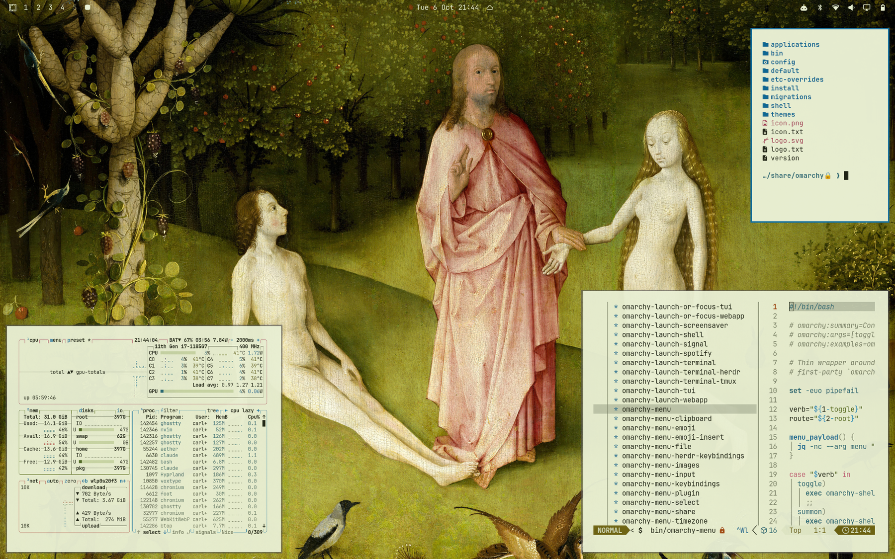
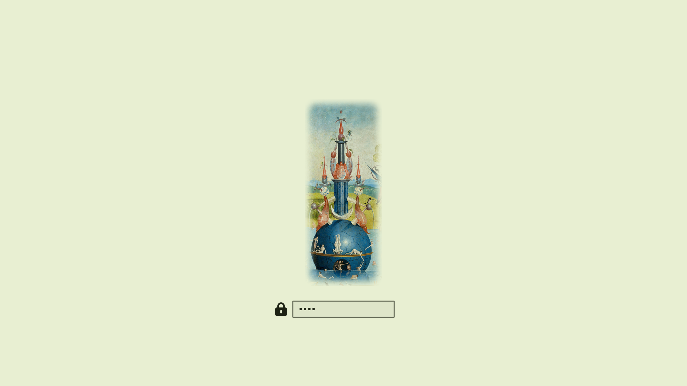

# El jardín de las delicias (claro) — tema para Omarchy

*[Español](#español) · [English](#english)*



---

## Español

Yo, Dalí, os lo confieso: antes que yo, hubo un holandés que soñaba despierto. Se llamaba El Bosco, y cuatrocientos años antes del surrealismo ya había pintado todo lo que yo iba a soñar. ¡Mirad sus torres rosadas, que no son de piedra sino de carne de fruta! ¡Mirad la esfera azul de la fuente, perfecta como un huevo cósmico! ¡Mirad a los amantes encerrados en una burbuja de cristal, que es la forma exacta del deseo, frágil y transparente!

Este tema abre las dos primeras puertas del tríptico: el Paraíso, donde Dios presenta a Eva ante Adán en un prado sin sombras, y el Jardín, donde la humanidad entera se entrega a la delicia entre fresas gigantes y pájaros del tamaño de un caballo. El verde del prado es ahora vuestro fondo; el azul de las esferas, vuestro acento; y cada color, un pigmento arrancado a la tabla. Trabajad en el Paraíso mientras dure: al otro lado de la bisagra os espera el Infierno.

*Texto escrito a la manera de Salvador Dalí, admirador de El Bosco. No es una cita suya.*

Un tema claro para [Omarchy](https://omarchy.org) basado en *El jardín de las delicias* de El Bosco, Museo del Prado. Todos los colores están ajustados para leerse con buen contraste sobre cualquiera de los tonos de fondo (WCAG 4,5:1).

Su pareja oscura, sacada de la tabla del Infierno: [El jardín de las delicias (oscuro)](https://github.com/carloschida/omarchy-jardin-de-las-delicias-oscuro-theme).

### Instalación

```bash
omarchy theme install https://github.com/carloschida/omarchy-jardin-de-las-delicias-claro-theme
```

Después, elígelo en el selector de temas o ejecuta `omarchy theme set jardin-de-las-delicias-claro`.

### Fondos de pantalla

Once encuadres en 4K (3840 × 2400), recortados del escaneo en alta resolución del Bosch Research and Conservation Project.

Del Paraíso (tabla izquierda):

1. Las montañas del Paraíso
2. La jirafa y el elefante
3. La Fuente de la Vida
4. Dios presenta a Eva ante Adán

Del Jardín (tabla central):

5. El jardín de las delicias
6. Las fuentes de los cuatro ríos
7. La cabalgata alrededor del estanque
8. Los pájaros gigantes
9. La burbuja de los amantes
10. El búho y la pareja de cristal
11. Los frutos gigantes

Los fondos son 16:10 y están compuestos para que nada importante se pierda en pantallas 16:9. Cambia de fondo con `omarchy theme bg next`.

### Extras

- **Pantalla de desbloqueo** (`unlock.png`): la esfera azul de la fuente de los cuatro ríos. Actívala con `omarchy plymouth set by theme jardin-de-las-delicias-claro`.
- **Teclado RGB** (`keyboard.rgb`): el azul de las esferas, para portátiles compatibles.



### Créditos y licencia

*El jardín de las delicias*, El Bosco, hacia 1490–1500. Óleo sobre tabla de roble. Museo del Prado, Madrid.
Imágenes a partir del escaneo del [Bosch Research and Conservation Project](https://commons.wikimedia.org/wiki/File:The_Garden_of_earthly_delights.jpg) publicado en Wikimedia Commons. La obra y sus reproducciones fieles son de **dominio público**.

Los archivos del tema (colores, configuración y este README) se publican bajo la [licencia MIT](LICENSE). Las imágenes no están sujetas a esa licencia: son de dominio público.

---

## English

I, Dalí, confess it to you: before me there was a Dutchman who dreamed with his eyes open. His name was Bosch, and four hundred years before Surrealism he had already painted everything I was going to dream. Look at his pink towers, made not of stone but of fruit flesh! Look at the blue sphere of the fountain, perfect as a cosmic egg! Look at the lovers sealed inside a glass bubble, which is the exact shape of desire, fragile and transparent!

This theme opens the first two doors of the triptych: Paradise, where God presents Eve to Adam in a meadow without shadows, and the Garden, where all of humanity surrenders to delight among giant strawberries and birds the size of horses. The green of the meadow is now your background; the blue of the spheres, your accent; and every colour, a pigment torn from the panel. Work in Paradise while it lasts: on the other side of the hinge, Hell is waiting for you.

*Written in the manner of Salvador Dalí, an admirer of Bosch. Not a quotation of his.*

A light theme for [Omarchy](https://omarchy.org) based on *The Garden of Earthly Delights* (*El jardín de las delicias*) by Hieronymus Bosch, known in Spanish as El Bosco, Museo del Prado. Every colour is tuned for readable contrast on any of the background shades (WCAG 4.5:1).

Its dark companion, taken from the Hell panel: [El jardín de las delicias (oscuro)](https://github.com/carloschida/omarchy-jardin-de-las-delicias-oscuro-theme).

### Installation

```bash
omarchy theme install https://github.com/carloschida/omarchy-jardin-de-las-delicias-claro-theme
```

Then pick it in the theme switcher or run `omarchy theme set jardin-de-las-delicias-claro`.

### Wallpapers

Eleven crops in 4K (3840 × 2400), cut from the Bosch Research and Conservation Project's high-resolution scan. Titles are in Spanish:

From Paradise (left panel):

1. Las montañas del Paraíso — *The mountains of Paradise*
2. La jirafa y el elefante — *The giraffe and the elephant*
3. La Fuente de la Vida — *The Fountain of Life*
4. Dios presenta a Eva ante Adán — *God presents Eve to Adam*

From the Garden (centre panel):

5. El jardín de las delicias — *The Garden of Earthly Delights*
6. Las fuentes de los cuatro ríos — *The fountains of the four rivers*
7. La cabalgata alrededor del estanque — *The cavalcade around the pond*
8. Los pájaros gigantes — *The giant birds*
9. La burbuja de los amantes — *The lovers' bubble*
10. El búho y la pareja de cristal — *The owl and the couple in glass*
11. Los frutos gigantes — *The giant fruits*

The wallpapers are 16:10 and composed so nothing important is lost on 16:9 screens. Cycle through them with `omarchy theme bg next`.

### Extras

- **Unlock screen** (`unlock.png`): the blue sphere of the fountain of the four rivers. Enable it with `omarchy plymouth set by theme jardin-de-las-delicias-claro`.
- **RGB keyboard** (`keyboard.rgb`): the blue of the spheres, for supported laptops.

### Credits and license

*The Garden of Earthly Delights* (*El jardín de las delicias*), Hieronymus Bosch (El Bosco), c. 1490–1500. Oil on oak panel. Museo del Prado, Madrid.
Images from the [Bosch Research and Conservation Project](https://commons.wikimedia.org/wiki/File:The_Garden_of_earthly_delights.jpg) scan published on Wikimedia Commons. The painting and faithful reproductions of it are in the **public domain**.

The theme files (colours, configuration and this README) are released under the [MIT License](LICENSE). The images are not covered by that license: they are in the public domain.
